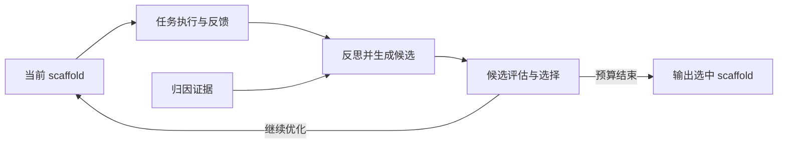
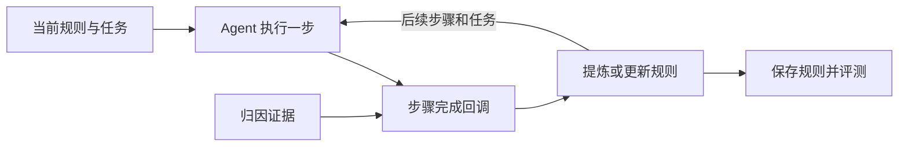
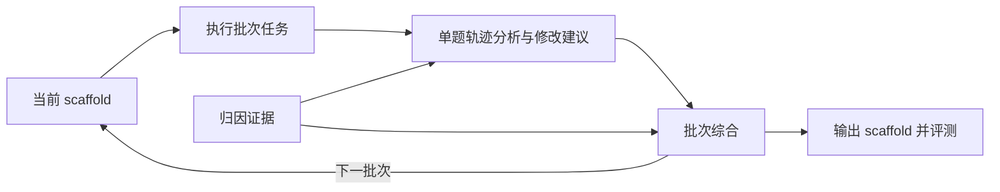
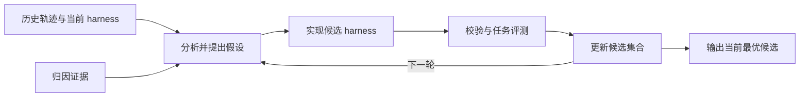
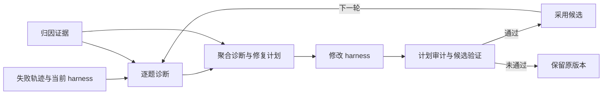

# Attribution Factor：Agent 错误归因与 Harness 优化

本项目研究：将 Agent 失败轨迹中的关键步骤和执行依赖提供给 harness 优化方法，是否有助于改进 Agent 的提示词、执行策略或框架代码。

仓库包含五种方法的源码与实验适配器：**GEPA、SCOPE、ReCreate、Meta-Harness、HarnessFix**。每种方法都支持一个不提供额外归因信息的 Baseline，以及 1.1–3.3 共九种信息条件。任务模型和优化模型通过环境变量配置，可使用不同的模型和 OpenAI 兼容 API。

当前执行适配面向 SWE-bench 类代码任务和 mini-swe-agent v2.4.6 格式轨迹。换用其他 Agent 时，需要将轨迹和归因结果转换为下述格式；如果工具接口、harness 或评测环境发生变化，还需要调整执行与评测适配器。

## 目录结构

| 路径 | 用途 |
| --- | --- |
| `baselines/` | 五种方法的上游代码及本项目的修改 |
| `agent_runtime/mini-swe-agent-v2.4.6/` | 实验使用的共享任务 Agent |
| `attribution_experiments/{gepa,scope,recreate,meta_harness,harnessfix}/` | 方法入口与证据注入适配器 |
| `attribution_experiments/common/analysis_payloads.py` | 生成 Baseline 与 1.1–3.3 条件 |
| `attribution_experiments/common/position_evidence.py` | 根据步骤位置提取原始轨迹内容 |
| `attribution_experiments/position_native.py` | 位置证据协议的统一方法入口 |
| `attribution_experiments/tests/` | 离线测试和测试样例 |

仓库不包含本项目的历史实验结果、私有轨迹、API 密钥、模型权重、容器镜像或评测数据集。

## 四种基础归因信息

四种因素都来自对**原始失败轨迹及生成该轨迹的 Agent harness**的分析。下面使用一个虚构代码修复任务：Agent 修改代码并运行测试，测试失败，但随后仍提交了补丁。

### 1. Causing：致错步骤

`failure_causing_wrong_step` 标识引入或促成失败的关键错误步骤。例如，Agent 在第 2 个 assistant 步骤实现功能时遗漏空值处理：

```json
{
  "failure_causing_wrong_step": {
    "step": 2,
    "message_index": 3,
    "role": "implementation",
    "what_went_wrong": "实现只处理普通输入，遗漏空值分支。",
    "evidence": "该步骤写入的补丁没有检查输入是否为空。"
  }
}
```

### 2. Inevitable：最后恢复责任点

`failure_inevitable_step` 标识失败无法再在后续责任步骤中挽回的关键位置。例如，Agent 在看到测试失败后，于第 3 步仍决定提交：

```json
{
  "failure_inevitable_step": {
    "step": 3,
    "message_index": 5,
    "role": "final_review",
    "what_went_wrong": "测试失败后仍提交补丁。",
    "evidence": "该步骤发出提交命令，没有进一步修复或验证。"
  }
}
```

`step` 从 1 开始，只计算 assistant 消息；`message_index` 从 0 开始，计算轨迹中的所有消息。两者必须指向同一条 assistant 消息。生成器会移除 `recoverability` 和 `why_inevitable_here`，避免将额外的恢复建议或不可避免性结论作为归因输入。

### 3. Control-flow：控制流

控制流描述步骤之间**如何转移和决策**。例如，测试失败后，执行流程仍从“运行测试”进入“提交”：

```json
{
  "control_flow": {
    "nodes": [
      {"node_id": "control-test", "step": 2, "observed_outcome": "测试失败"},
      {"node_id": "control-submit", "step": 3, "observed_outcome": "提交补丁"}
    ],
    "edges": [
      {
        "source": "control-test",
        "target": "control-submit",
        "type": "next_decision",
        "explanation": "测试失败后，Agent 进入提交步骤。"
      }
    ]
  }
}
```

### 4. Data-flow：数据流

数据流描述信息或数据**在哪里产生、传递及被使用或忽略**。同一个例子中，失败测试输出被传给 Agent，但没有约束提交决策：

```json
{
  "data_flow": {
    "nodes": [
      {"node_id": "data-test-output", "step": 2, "information_handling": "产生失败测试输出"},
      {"node_id": "data-submit", "step": 3, "information_handling": "提交决策未采纳该输出"}
    ],
    "edges": [
      {
        "source": "data-test-output",
        "target": "data-submit",
        "type": "ignored_observation",
        "explanation": "失败输出未阻止后续提交。"
      }
    ]
  }
}
```

以上只是字段示例。实际图需要结合轨迹和 harness 分析：控制流可包含工具调用、分支和终止；数据流可包含参数、文件、工具输出、上下文及其依赖。项目传递提供的节点和边，并为其生成可引用的 `evidence_ref`；图的语义正确性需要独立审核。

## 实验条件

| 条件 | 额外提供给方法的信息 |
| --- | --- |
| Baseline | 不提供归因信息；方法仍使用自己的原生反馈 |
| 1.1 Causing | 致错步骤 |
| 1.2 Inevitable | 最后恢复责任点 |
| 1.3 Both | 同时提供两个步骤 |
| 2.1 Causing shift | 将致错步骤移位 |
| 2.2 Inevitable shift | 将最后恢复责任点移位 |
| 2.3 Both shift | 将两个步骤分别移位 |
| 3.1 Causing + flow | 致错步骤及其控制流、数据流上下文 |
| 3.2 Inevitable + flow | 最后恢复责任点及其控制流、数据流上下文 |
| 3.3 Both + flow | 两个步骤及各自的控制流、数据流上下文 |

移位范围为 `-3、-2、-1、+1、+2、+3` 个 assistant 步骤，并排除超出轨迹范围的位置；选择由任务 ID、锚点类型和随机种子确定。双移位分别计算两个锚点的偏移量。flow 组使用以各锚点为中心、前后最多 3 个步骤的图窗口，轨迹边界处的窗口会缩短。

### 两种输入协议

- **位置加诊断的旧协议**：传入 `step`、`message_index`、角色、错误描述和证据文字。移位组只更改位置，保留原诊断文字，因此仍可能泄露原始位置的线索。
- **位置证据协议**：锚点只提供 `step` 和 `message_index`，并从原始轨迹中读取对应 assistant 消息及其后续观察。移位组读取移位后的内容；3.x 另加控制流和数据流图。该协议不附加 `what_went_wrong` 或 `evidence` 等人工诊断。

两种协议改变的信息内容不同，结果需要分别记录。位置提取最多展示每个锚点 8,000 个字符，并提供读取完整步骤的命令；它验证索引与原始消息是否一致，归因本身仍需独立审核。

## 五种 Baseline 与信息注入

下面的 Mermaid 图可在 GitHub 上直接渲染。图中的“归因证据”根据所选条件可以是 Causing、Inevitable、两者、移位位置或附带的 flow 图；Baseline 不注入该分支。循环表示可以继续处理批次或候选，实际轮次由启动参数控制。

### GEPA

GEPA 使用任务反馈和反思模型生成 harness 候选，通过候选评估选择保留的版本。本项目主要优化共享 scaffold 的文本字段。



**注入点**：证据作为每题反馈中的独立反思信息进入反思阶段，与当前候选的执行结果并列；flow 组也提供图节点和依赖关系。候选经过评估后可能被拒绝，最终也可能保留原 scaffold。

### SCOPE

SCOPE 在 Agent 执行期间分析每一步的动作与观察，形成可复用的策略或指导规则，并在后续执行中使用。



**注入点**：证据进入 `on_step_complete` 的任务上下文，与当前动作和观察一起交给优化器。flow 组区分历史依赖与当前 rollout，优化器据此决定是否生成可迁移的规则。

### ReCreate

ReCreate 先针对单题执行结果生成局部修改建议，再综合一个批次的建议，更新共享 Agent 的 scaffold。



**注入点**：单题证据放在独立结果字段中，供每题分析使用；位置协议下证据还随局部建议传递到批次综合阶段。flow 图也参与综合。当前共享运行时适配使用 mini-swe-agent v2.4.6。

### Meta-Harness

Meta-Harness 分析历史轨迹，提出一个可检验的 harness 改进假设，交给实现阶段构造候选，再验证并更新候选集合。



**注入点**：每题证据写入分析工作区的 `provided_analysis/`，由分析阶段与原始轨迹共同读取；flow 组提供可引用的图节点和边。之后实现阶段依据分析提案修改代码或配置。

### HarnessFix

HarnessFix 对失败轨迹逐题诊断，聚合缺陷形成修复计划，修改 harness 后通过校验和候选晋升机制决定是否采用。



**注入点**：位置证据进入逐题诊断；诊断摘要和位置引用也进入聚合器的初始输入。flow 组同时向诊断和聚合提供相应图证据。候选必须通过审计与验证门槛才会被采用。

## 数据准备

每个任务需要一条原始轨迹、一份归因分析和一份 flow 图。生成器当前会一次生成所有条件，因此即使只打算运行非 flow 组，也需要提供图文件。

1. **任务列表**：UTF-8 文本，每行一个唯一任务 ID。位置协议要求 ID 仅包含字母、数字、`.`、`_` 和 `-`。
2. **归因分析**：`<分析目录>/<任务ID>.analysis.json`。包含 `schema_version: "2.0"`、`classification: "confirmed_agent_failure"`、`trace.path` 和 `step_attribution`，后者包含上述两个锚点。
3. **原始轨迹**：JSON 对象，包含 `messages` 数组；锚点的 `step` 与 `message_index` 必须对应同一条 assistant 消息。消息和工具动作应遵循所使用的 Agent 适配器格式。
4. **flow 图**：`<图目录>/<任务ID>.graph.json`，包含 `schema_version: "1.0"`、`task_id`、`canonical_scaffold_version` 和 `windows`。`windows` 分别以两个锚点名称为键；每个窗口包含 `center_step`、连续的 `window_steps`，以及上文所示的 `control_flow`、`data_flow`。
5. **任务与评测环境**：执行实验时，需要包含 `instance_id`、`repo`、`problem_statement` 等字段的 SWE-bench 兼容 parquet 数据、对应容器镜像和评测依赖。
6. **参考轨迹**：执行实验时，需要一条包含 `info.config.agent`、`info.config.model`、`info.config.environment` 的参考轨迹，用于初始化原始 scaffold。它应对应实际评测的 Agent，且不应包含凭据。

下面是可生成条件的数据文件结构示例。`trace.path` 应替换成实际轨迹路径；两个 flow 窗口分别围绕第 2 步和第 3 步。

<details>
<summary>示例：归因分析与 flow 图</summary>

`<分析目录>/example-task.analysis.json`：

```json
{
  "schema_version": "2.0",
  "classification": "confirmed_agent_failure",
  "trace": {"path": "/path/to/example-task.trace.json"},
  "step_attribution": {
    "failure_causing_wrong_step": {"step": 2, "message_index": 3},
    "failure_inevitable_step": {"step": 3, "message_index": 5}
  }
}
```

`<图目录>/example-task.graph.json`：

```json
{
  "schema_version": "1.0",
  "task_id": "example-task",
  "canonical_scaffold_version": "agent-v1",
  "windows": {
    "failure_causing_wrong_step": {
      "center_step": 2,
      "window_steps": [1, 2, 3],
      "control_flow": {
        "nodes": [{"node_id": "control-2", "step": 2}, {"node_id": "control-3", "step": 3}],
        "edges": [{"source": "control-2", "target": "control-3", "type": "next_decision"}]
      },
      "data_flow": {
        "nodes": [{"node_id": "output-2", "step": 2}, {"node_id": "decision-3", "step": 3}],
        "edges": [{"source": "output-2", "target": "decision-3", "type": "ignored_observation"}]
      }
    },
    "failure_inevitable_step": {
      "center_step": 3,
      "window_steps": [1, 2, 3],
      "control_flow": {
        "nodes": [{"node_id": "control-2", "step": 2}, {"node_id": "control-3", "step": 3}],
        "edges": [{"source": "control-2", "target": "control-3", "type": "next_decision"}]
      },
      "data_flow": {
        "nodes": [{"node_id": "output-2", "step": 2}, {"node_id": "decision-3", "step": 3}],
        "edges": [{"source": "output-2", "target": "decision-3", "type": "ignored_observation"}]
      }
    }
  }
}
```

该示例的轨迹应至少有 3 个 assistant 消息，且第 2、3 个 assistant 消息分别位于 `messages[3]` 和 `messages[5]`。

</details>

## 生成条件与配置模型

在项目规定的持久存储中准备输入，然后在仓库根目录执行：

```bash
export ATTRIBUTION_TASK_IDS=/path/to/task_ids.txt
export ATTRIBUTION_ANALYSIS_ROOT=/path/to/analysis
export ATTRIBUTION_GRAPH_ROOT=/path/to/graphs
export ATTRIBUTION_PARQUET=/path/to/tasks.parquet
export ATTRIBUTION_REFERENCE_TRACE=/path/to/reference.traj.json
export ATTRIBUTION_PAYLOAD_ROOT="$PWD/attribution_experiments/payloads"

python -m attribution_experiments.generate_payloads
python -m attribution_experiments.common.position_evidence --generate
```

第一条命令生成位置加诊断的旧协议，第二条读取这些 payload 并生成位置证据协议。旧协议生成器会覆盖输出目录中的同名文件，请使用新目录；位置协议生成器会拒绝覆盖已有输出。位置协议会记录轨迹与 payload 的校验和，续跑时需要保持输入文件一致。

配置任务模型和优化模型：

```bash
export TASK_MODEL=TASK_MODEL
export TASK_MODEL_BASE_URL=http://localhost:8001/v1
export TASK_MODEL_API_KEY=YOUR_TASK_MODEL_API_KEY
export OPTIMIZER_MODEL=OPTIMIZER_MODEL
export OPTIMIZER_BASE_URL=http://localhost:8000/v1
export OPTIMIZER_API_KEY=YOUR_OPTIMIZER_API_KEY
```

将示例中的模型名、地址和密钥替换为实际配置。若服务要求占位密钥，可显式使用 `EMPTY`。服务商特定的请求参数可放在 `TASK_MODEL_EXTRA_BODY` 中，格式为 JSON 对象，默认不发送。ReCreate 当前依据模型名区分任务与优化 API，因此两个模型标识需要不同。

不调用模型，仅检查某个位置协议条件：

```bash
python -m attribution_experiments.position_native \
  --method gepa --group group2_1_causing_shifted --validate-only
```

该检查需要已生成的位置协议 manifest 和至少 3 个任务。实际运行前还需安装各 baseline 的依赖，配置兼容的容器后端和评测环境。当前运行代码仍包含 `/volume/med` 持久化路径、`server241` 远端 Docker、部分 `native_baseline_runs/.venv` 路径及 SWE-bench 镜像命名等原环境假设，迁移时需要按实际环境调整。新数据集尚未完成端到端验证；划分数据时也应单独记录训练、候选选择和最终评测是否重叠。

## 预算、环境和来源

- GEPA、SCOPE、ReCreate 按批次更新；HarnessFix、Meta-Harness 按外层轮次更新。历史配置中前者使用 10 个批次，后者使用 1 轮；相同任务覆盖量不代表相同的模型调用次数。
- HarnessFix 的实验入口依赖 Python 3.11 字节码 `run_native_impl_bounded_validation.cpython-311.pyc`；原工作区未保存该入口对应版本的源码。仓库中的 HarnessFix 上游源码与此适配器是不同部分。
- 本项目环境中只有 `/volume/med` 是持久存储；实验运行文件、缓存和测试临时目录应放在该挂载下，遵循项目 `AGENTS.md` 的运行存储要求。
- 本地上游快照来源：GEPA `65130973`、SCOPE `4dc0da5e`、ReCreate `442c77f2`、Meta-Harness `44b99421`、HarnessFix `831913a5`。快照包含本项目的修改；复用前请查阅各目录的许可证与引用信息。HarnessFix 原始快照没有顶层许可证，复用前应确认其上游授权。
